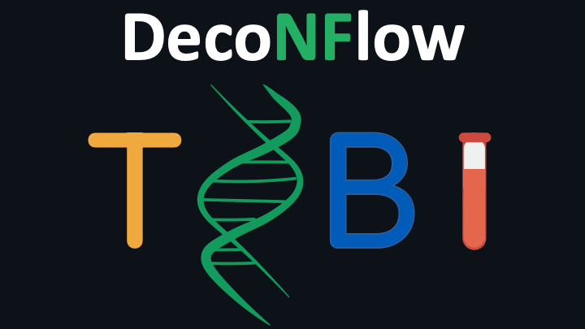

---
hide:
  - navigation
  - toc
---

<div class="dnf-hero" markdown>

{ .dnf-hero__logo }

# DecoNFlow

<p class="dnf-hero__tagline">Computational deconvolution of DNA methylation data, with reference-based and reference-free tools in one Nextflow pipeline.</p>

[Get started](#quick-start){ .md-button .md-button--primary }
[Usage](usage.md){ .md-button }

[](https://www.nextflow.io/)
[](https://www.docker.com/)
[](https://sylabs.io/docs/)
[](https://github.com/askimed/nf-test)

</div>

DecoNFlow estimates the cell type composition of bulk DNA methylation samples. It selects differentially methylated regions (DMRs) from reference samples, runs reference-based and reference-free deconvolution tools, and compares their estimates in an HTML report, including an evaluation against the expected proportions when they are known. It also allows benchmarking all the tools included in the pipeline.

<div class="grid cards dnf-cards" markdown>

-   :material-rocket-launch:{ .lg .middle } **Quick start**

    ---

    Prepare the samplesheets, pick the tools and run the pipeline with Docker or Singularity.

    [:octicons-arrow-right-24: Quick start](#quick-start)

-   :material-file-document-edit-outline:{ .lg .middle } **Usage**

    ---

    Reference and bulk samples, coverage files, reference matrices, regions and ground truth.

    [:octicons-arrow-right-24: Usage](usage.md)

-   :material-tune-variant:{ .lg .middle } **Parameters**

    ---

    Every parameter of the pipeline, generated from its parameter schema.

    [:octicons-arrow-right-24: Parameters](parameters.md)

-   :material-chart-bar-stacked:{ .lg .middle } **Output**

    ---

    The combined proportions of all tools, the HTML report and the intermediate files.

    [:octicons-arrow-right-24: Output](output.md)

</div>

## Pipeline overview

[](images/deconflow_metro.html)

_Click the map to open the interactive version, which you can pan, zoom and filter by line._

| Step | Tools |
| --- | --- |
| DMR selection | limma |
| Reference-based deconvolution, beta values | meth_atlas, CIBERSORT, EpiDISH, Houseman's CP (equality), Houseman's CP (inequality), EpiSCORE, MethylResolver, PRMeth |
| Reference-based deconvolution, read counts | CelFiE, MetDecode |
| Reference-free deconvolution | MeDeCom, RefFreeCellMix |

The methylation data of the reference and bulk samples can be provided as Bismark coverage files (`.cov.gz`) or MethylDackel bedGraph files (`.bedGraph.gz`).

## Quick start

!!! tip "New to Nextflow?"

    See [this page](https://nf-co.re/docs/usage/getting_started/installation) on how to set up Nextflow (>= 26.04.0) and Docker or Singularity.

1.  Prepare a samplesheet with the [bulk samples](usage.md#bulk-samples) to deconvolve and, for reference-based deconvolution, a samplesheet with the [reference samples](usage.md#reference-samples).
2.  Select at least one deconvolution tool (e.g. `--meth_atlas`). Reference-based tools need the reference samples (`--input`) together with a regions file (`--regions`) for the limma DMR selection, or a reference matrix (`--ref_matrix`). CelFiE and MetDecode need read counts instead of beta values, so they use the reference samples or their own reference matrix (`--celfie_ref_matrix`, `--metdecode_ref_matrix`).
3.  Write the parameters in `params.yaml`:

    ```yaml title="params.yaml"
    input: ./resources/reference.csv
    bulk_samples: ./resources/bulk_samples.csv
    regions: ./resources/regions.bed
    outdir: ./results
    meth_atlas: true
    ```

4.  Run the pipeline:

    === "Docker"

        ```bash
        nextflow run VIBTOBIlab/DecoNFlow -params-file params.yaml -profile docker
        ```

    === "Singularity"

        ```bash
        nextflow run VIBTOBIlab/DecoNFlow -params-file params.yaml -profile singularity
        ```

Allocate at least 8 CPUs and 16 GB of RAM to run the pipeline. The results are described on the [output](output.md) page.

## Credits

The scripts and containers have been written and built by Edoardo Giuili ([@edogiuili](https://github.com/edogiuili)), Maísa Santos ([@mferrodo](https://github.com/mferrodo)) and Sofie Van de Velde ([@sofvdvel](https://github.com/sofvdvel)), who are also the maintainers.

## Citation

If you use this pipeline for your analysis, please cite:

!!! quote ""

    **A benchmark of DNA methylation deconvolution methods for tumoral fraction estimation using DecoNFlow**

    Edoardo Giuili, Sofie Van de Velde, Sam Kint, Maísa R Ferro dos Santos, Lotte Cornelli, Sofie Roelandt, Kathleen Schoofs, Renske Imschoot, Ruben Van Paemel, Leander Meuris, Celine Everaert, Katleen De Preter.

    bioRxiv 2025 Nov 27. doi: [10.1101/2025.11.27.688590](https://www.biorxiv.org/content/10.1101/2025.11.27.688590v1)

The tools used by the pipeline are listed on the [citations](citations.md) page.
