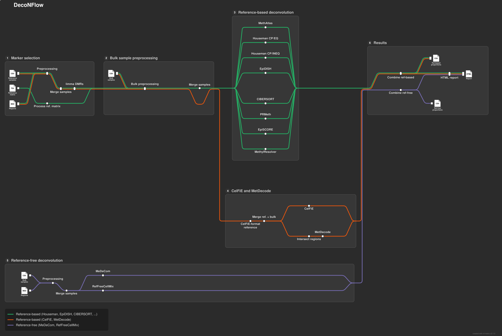

# DecoNFlow

[](https://www.nextflow.io/)
[](https://www.docker.com/)
[](https://sylabs.io/docs/)
[](https://github.com/askimed/nf-test)

DecoNFlow is a bioinformatics analysis pipeline used for computational deconvolution of DNA methylation data. It allows deconvolution of samples using both reference-based and reference-free deconvolution tools. It also allows benchmarking of the different tools included in the pipeline.

The pipeline is built using [Nextflow](https://www.nextflow.io/) (>=26.04.0), a workflow tool to run tasks across multiple compute infrastructures in a very portable manner. It uses Docker / Singularity containers making installation trivial and results highly reproducible.

## Pipeline summary

[](images/deconflow_metro.html)

_Click the map to open the interactive version, which you can pan, zoom and filter by line._

- **DMR selection**: limma
- **Reference-based deconvolution**:
  - beta values: meth_atlas, CIBERSORT, EpiDISH, Houseman's CP (equality), Houseman's CP (inequality), EpiSCORE, MethylResolver, PRMeth
  - read counts: CelFiE, MetDecode
- **Reference-free deconvolution**: MeDeCom, RefFreeCellMix

The methylation data of the reference and bulk samples can be provided as Bismark coverage files (`.cov.gz`) or MethylDackel bedGraph files (`.bedGraph.gz`).

## Quick start

!!! note

    If you are new to Nextflow, please refer to [this page](https://nf-co.re/docs/usage/getting_started/installation) on how to set up Nextflow.

1. Prepare a samplesheet with the [bulk samples](usage.md#bulk-samples) to deconvolve and, for reference-based deconvolution, a samplesheet with the [reference samples](usage.md#reference-samples).
2. Select at least one deconvolution tool (e.g. `--meth_atlas`). Reference-based tools need the reference samples (`--input`) together with a regions file (`--regions`) for the limma DMR selection, or a reference matrix (`--ref_matrix`). CelFiE and MetDecode need read counts instead of beta values, so they use the reference samples or their own reference matrix (`--celfie_ref_matrix`, `--metdecode_ref_matrix`).
3. Run the pipeline with Docker or Singularity:

   ```bash
   nextflow run VIBTOBIlab/DecoNFlow -params-file params.yaml -profile docker
   ```

   with the parameters in `params.yaml`:

   ```yaml
   input: ./resources/reference.csv
   bulk_samples: ./resources/bulk_samples.csv
   regions: ./resources/regions.bed
   outdir: ./results
   meth_atlas: true
   ```

You need to allocate at least 8 CPUs and 16 GB of RAM to run the pipeline. See the [usage](usage.md) page for all the inputs and options, the [parameters](parameters.md) page for the full list of parameters and the [output](output.md) page for the results.

## Credits

The scripts and containers have been written and built by Edoardo Giuili ([@edogiuili](https://github.com/edogiuili)), Maísa Santos ([@mferrodo](https://github.com/mferrodo)) and Sofie Van de Velde ([@sofvdvel](https://github.com/sofvdvel)), who are also the maintainers.

## Citation

If you use this pipeline for your analysis, please cite:

> A benchmark of DNA methylation deconvolution methods for tumoral fraction estimation using DecoNFlow
>
> Edoardo Giuili, Sofie Van de Velde, Sam Kint, Maísa R Ferro dos Santos, Lotte Cornelli, Sofie Roelandt, Kathleen Schoofs, Renske Imschoot, Ruben Van Paemel, Leander Meuris, Celine Everaert, Katleen De Preter.
>
> bioRxiv 2025 Nov 27. doi: [10.1101/2025.11.27.688590](https://www.biorxiv.org/content/10.1101/2025.11.27.688590v1)

The tools used by the pipeline are listed on the [citations](citations.md) page.
